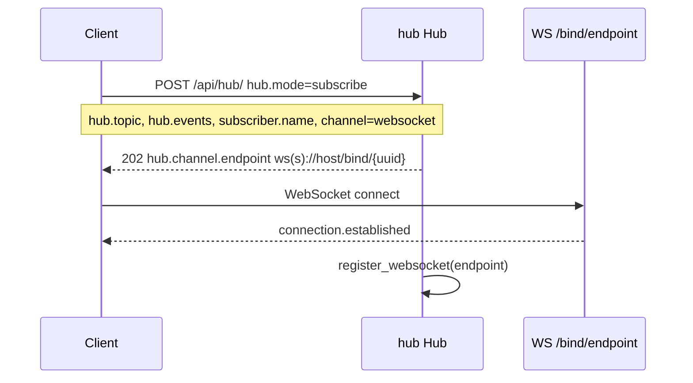
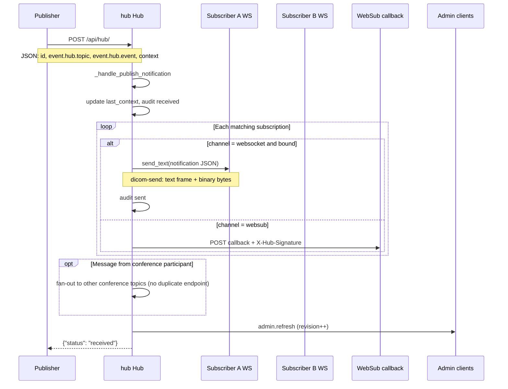
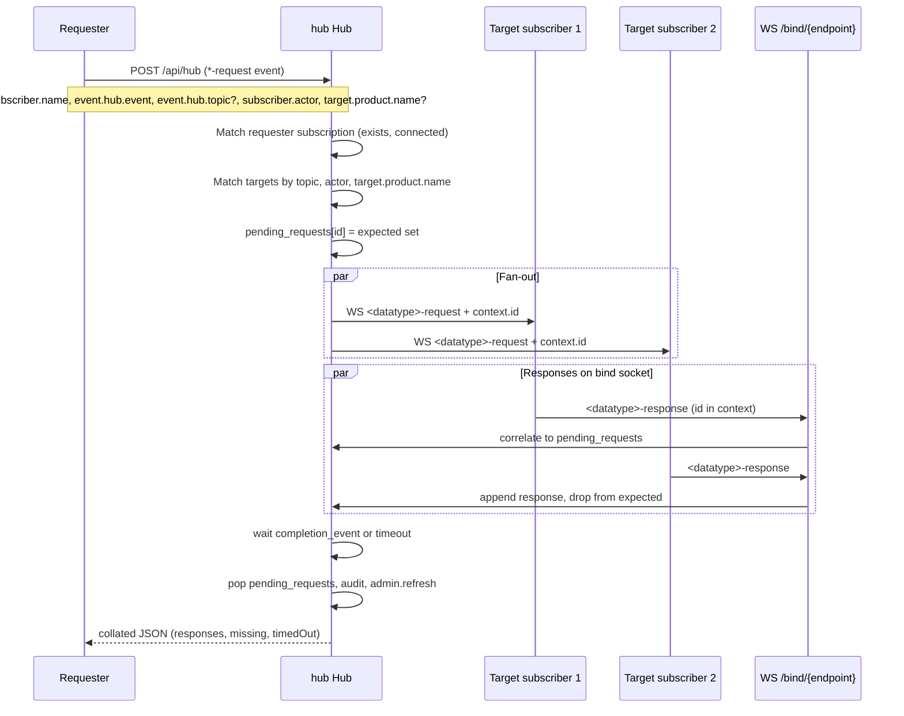

# Slicer Hub (`hub`)

FastAPI implementation of a [FHIRcast](https://fhircast.org/)-style hub for the Slicer Hub stack (`@slicer-hub/client`, OHIF hub extension, Slicer Image Display / service providers). Subscribers connect over WebSocket (`/bind/{endpoint}`) or WebSub callbacks; the hub fans out events and collates typed request/response traffic.

Run standalone:

```bash
cd HubInterface/hub
pip install -e ../python_client
pip install -r requirements.txt
python hub.py --port 2018
```

### Marketing site at `/`

Hub can serve the Bellehumeur Engineering static site at `GET /` (SPA clients stay under `/worklist-client/`, `/ohif/`, etc.).

**Local (point at a built `dist/`):**

```bash
# In bellehumeur-website
python build.py

# Then start hub with:
export HUB_WEBSITE_ROOT="/path/to/bellehumeur-website/dist"
python hub.py --port 2018
```

Open `http://127.0.0.1:2018/`.

**Packaged zip:** a deploy zip that includes `hub/website/index.html` (synced from `bellehumeur-website/dist`, gitignored) serves `/` without `HUB_WEBSITE_ROOT`.

Or with VolView RPC:

```bash
poetry run python server_with_hub.py --port 4014
```

## Core endpoints

| Method | Path | Purpose |
|--------|------|---------|
| `POST` | `/api/hub/` | Subscribe, unsubscribe, publish, or typed request (`event.hub.event` ending in `-request` → fan-out → collated HTTP response) |
| `WS` | `/bind/{endpoint}` | Receive hub events; send `<datatype>-response` for requests |
| `GET` | `/api/hub/admin` | Admin dashboard HTML |
| `GET` | `/api/hub/admin/snapshot` | JSON dashboard (subscriptions, conferences, audit) |
| `WS` | `/ws/admin` | `admin.refresh` notifications (revision bump) |
| `GET` | `/api/hub/auth/config` | Auth mode discovery (`mock` \| `oidc`) for HubClient |
| `GET` | `/oauth/login`, `/oauth/callback` | Browser OIDC (Google-ready PKCE); oidc mode only |
| `POST` | `/oauth/authorize`, `/oauth/token` | Dev/mock OAuth (503 when `HUB_AUTH_MODE=oidc`) |

### Authentication modes

Primary switch: **`HUB_AUTH_MODE=mock|oidc`** (default `mock`). Full setup (Auth0 / Entra / Google): [`oidc.md`](oidc.md).

| Mode | Hub settings | Client behavior |
|------|--------------|-----------------|
| **Mock (default)** | `HUB_AUTH_MODE=mock`, optional `HUB_REQUIRE_AUTH` | JS/Python clients `POST` `/oauth/*`; Bearer optional unless `HUB_REQUIRE_AUTH=true` |
| **OIDC (Google)** | `HUB_AUTH_MODE=oidc` + issuer/client/JWT secret | Browser login via HubClient; hub mints session JWT; Bearer required; topic must match JWT |
| **Admin token (hosted demos)** | `HUB_ADMIN_TOKEN=<secret>` | Admin snapshot/metrics/clear-audit/reset and `/ws/admin` require `X-Hub-Admin-Token` (or `?admin_token=` / Bearer equal to the secret) |

Bearer / admin-token validation lives in [`Lib/oauth_tokens.py`](Lib/oauth_tokens.py) (HS256 hub session + discovery JWKS for IdP id_tokens + `HUB_ADMIN_TOKEN`). Admin snapshot omits subscription `secret` values. `DELETE /api/hub` only unsubscribes a specific endpoint/callback+topic (no mass clear; use `POST /api/admin/reset`). Python `hub_client` OIDC is deferred (mock authorize only).

Conference UI: `/api/hub/conference-client`, APIs under `/api/hub/conference` and `/api/hub/conference-topics`.

Event names (`<datatype>-request` / `<datatype>-response` and fixed wire events) are defined in [`../python_client/src/hub_client/client.py`](../python_client/src/hub_client/client.py) and mirrored in `@slicer-hub/client` `eventNames.js`.

---

## Subscribe and bind (prerequisite)

Before publish or request traffic, a client subscribes and opens its bind socket.



---

## Publish flow

A publisher sends a Hub notification to the hub. The hub matches **topic + event type** against each subscription, skips echo to the publisher (`subscriber.name` on the envelope), and delivers to WebSocket or WebSub subscribers. Conference participants may receive an extra copy when the message topic matches an active conference.

**Entry point:** `POST /api/hub/` or `POST /api/hub` (body contains `event` with `event.hub.topic`).



**Matching rules**

- Subscription `topic` must equal `event.hub.topic`, or subscription `topic` may be
  `*` to receive publishes for **any** non-empty `event.hub.topic`.
- Subscription `events` must include the event or `*`.
- Optional publish filters: `target.actor` (role) and `target.product.name` on the notification root
  (matches `client_info.productName` on the subscription).
- Publisher subscriber name is not delivered a copy of its own publish.

### `subscription-removed` (hub lifecycle)

When a subscription is removed (explicit unsubscribe, WebSocket disconnect, send failure, or replaced by a resubscribe for the same `subscriber.name` + topic), the hub fans out a **`subscription-removed`** event to other subscribers on the same topic (same matching rules as publish). The removed peer does not receive the notification.

| Field | Description |
| --- | --- |
| `event.hub.event` | `subscription-removed` |
| `event.hub.topic` | Topic of the removed subscription |
| `subscriber.name` | Removed subscriber |
| `subscriber.product.name` | Optional product from subscription `client_info` |
| `event.context.reason` | `unsubscribe`, `websocket-disconnect`, `send-failure`, or `resubscribe` |
| `event.context.subscriber` | Same as `subscriber.name` |

Subscribe with `subscription-removed` in `hub.events` (or `*`) to receive these notifications.

**Binary file transfer:** binary batch only — `POST /api/hub/` as `multipart/related` (Hub JSON manifest + one part per `context.files[]` entry). Hub fans out one text WebSocket message with `files[].payloadId`; subscribers download via `GET /api/hub/payloads/{payloadId}` when the app calls `fetch_all_payloads`. Full write-up: Slicer extension `HubInterface/docs/binary-file-transfer.md` (same content as in a pw45 checkout). Legacy `multipart/form-data` returns HTTP 400.

**Filename policy:** When the hub stores binary bytes (HTTP payload store or multipart upload), `resource.fileName` must match an allowlisted suffix and pass a double-extension check. See [filename-policy.md](filename-policy.md). Disable with `HUB_FILENAME_POLICY=off`.

### DICOM send (`dicom-send`)

VolView publishes study/series/slice data as a single **binary batch** `dicom-send`: `context.files[]` manifest plus one `application/dicom` part per file (`multipart/related`). Receivers download bytes via `payloadId` when ready. Helpers: VolView `publishDicomSendSeries()` / `publishDicomSendForScope()` in [`hub-client.ts`](../../../src/io/hub-client.ts), `buildDicomSendManifest()` in [`build-dicom-send-manifest.ts`](../../../src/io/hub/build-dicom-send-manifest.ts).

---

## Hub request flow

A caller uses **HTTP** to ask the hub to dispatch a **typed** request to every matching subscriber. The request body includes top-level `id` and `timestamp` (like publish). Each target receives a WebSocket message with `hub.event = <datatype>-request` and `context.id` set to that correlation id. Targets reply on `/bind/{endpoint}` with `hub.event = <datatype>-response` and the same `context.id`. The hub waits (default 2s, `HUB_REQUEST_TIMEOUT_SECONDS`) and returns one collated JSON body.

**Entry point:** `POST /api/hub` when `event.hub.event` ends with `-request`



**Target matching**

| Field | Role |
|-------|------|
| `subscriber.name` | Requester identity (must have a subscription; should be WS-connected) |
| `event.hub.event` | Required `*-request` event name (for example `status-request`); hub dispatches this name as-is |
| `event.hub.topic` | Optional; all matches must use this hub topic |
| `event.context.dataType` | Optional handler token (lowercase; for example `status`, `pngfullsize`); copied into WS fan-out `context`. Uppercase aliases still work via client normalize. |
| `subscriber.actor` | Source / requester role (included on forwarded WS events) |
| `target.actor` | Destination filter: subscription `actors` must include this keyword; omitted or `*` = all roles on topic. On POST request body, if `target.actor` is absent, `subscriber.actor` may be used as the filter. WS fan-out uses the same keys. |
| `productName` | Optional filter on `client_info.productName`; `*` means any |

**Event names:** clients send `event.hub.event` as the `*-request` name (build with `request_event_for` from a data-type token). Responses use the matching `*-response` name. Collated HTTP replies still include a top-level `dataType` derived from `event.context.dataType` or the request event name.

**Example request body:**

```json
{
  "subscriber.name": "VolView-ABC123",
  "event": {
    "hub.topic": "my-topic",
    "hub.event": "status-request",
    "context": { "dataType": "status" }
  },
  "subscriber.actor": "WORKLIST_CLIENT",
  "target.actor": "WORKLIST_CLIENT"
}
```

**Collated HTTP response (success shape):**

```json
{
  "ok": true,
  "id": "<uuid>",
  "subscriber.name": "REQUESTER-NAME",
  "dataType": "jpgfullsize",
  "subscriber.actor": "ID",
  "target.actor": "*",
  "responses": [
    {
      "id": "<envelope-id>",
      "subscriber": "VIEWER-ABC",
      "actor": "ID",
      "productName": "OHIF",
      "data": { }
    }
  ],
  "expected": ["VIEWER-ABC"],
  "missing": [],
  "timedOut": false
}
```

Each item in `responses` is one subscriber's `<datatype>-response` payload. The envelope `id` is the message id from the WebSocket event, not a separate `responseId` field.

`SCENEVIEW` uses the same WebSocket fan-out as other data types (`sceneview-request` / `sceneview-response`). Notes for implementing sceneview on the 3D Slicer side are in the HubInterface module's `sceneview-readme.md`.

---

## Admin dashboard

- **HTTP:** `GET /api/hub/admin/snapshot` — full state for the UI (subscription `secret` omitted). Gated when `HUB_ADMIN_TOKEN` or `HUB_REQUIRE_AUTH` is set.
- **WebSocket:** `WS /ws/admin` — lightweight `admin.refresh` with `revision`; the page reloads snapshot when revision changes. Pass `?admin_token=` when gated.
- **Reset:** `POST /api/admin/reset` — clears subscriptions, audit, conferences, auth codes; optional `single_user_mode`. Same admin gate as snapshot.
- **Unsubscribe only:** `DELETE /api/hub` with `hub.channel.endpoint` and/or `hub.callback`+`hub.topic`. Empty DELETE no longer clears all subscriptions.

---

## Related files

| File | Role |
|------|------|
| [`hub.py`](hub.py) | Thin FastAPI entrypoint (bootstrap, middleware, SPA mounts, uvicorn `main`) |
| [`admin.html`](admin.html) | Admin UI |
| [`../python_client/src/hub_client/client.py`](../python_client/src/hub_client/client.py) | Per-`dataType` event-name helpers + fixed events; `HubClient` ABC and `SlicerHubClient` |
| [`3dslicer-hub-ai-interface.py`](3dslicer-hub-ai-interface.py) | Standalone Hub subscriber (hub URLs from OHIF `hub.js`) |
| [`HUB-README.md`](HUB-README.md) | VolView server run/deploy guide |

### `Lib/` modules (on `sys.path` when running `hub.py`)

| Module | Role |
|--------|------|
| [`Lib/env.py`](Lib/env.py) | Env flags / tunables (`HUB_WS_*`, payload store, request timeout) |
| [`Lib/logging_setup.py`](Lib/logging_setup.py) | `hub` logger + uvicorn access-log filter |
| [`Lib/state.py`](Lib/state.py) | `Hub` class + `hub` singleton |
| [`Lib/subscriptions.py`](Lib/subscriptions.py) | Topic/event/actor/product match helpers |
| [`Lib/payload_store.py`](Lib/payload_store.py) | In-memory `payloadId` store + reaper |
| [`Lib/request_parse.py`](Lib/request_parse.py) | Hub-request body field parsers |
| [`Lib/audit_helpers.py`](Lib/audit_helpers.py) | Publisher + audit message params |
| [`Lib/publish.py`](Lib/publish.py) | Publish / multipart fan-out |
| [`Lib/binary_publish.py`](Lib/binary_publish.py) | Multipart parse + payloadId rewrite |
| [`Lib/hub_request.py`](Lib/hub_request.py) | Typed `*-request` collation |
| [`Lib/conference_logic.py`](Lib/conference_logic.py) | Conference topic / event helpers |
| [`Lib/samples.py`](Lib/samples.py) | Sample study catalog helpers |
| [`Lib/public_url.py`](Lib/public_url.py) | Public base URL behind reverse proxies |
| [`Lib/static_spa.py`](Lib/static_spa.py) | Bundled SPA + root site mounts |
| [`Lib/http_util.py`](Lib/http_util.py) | Shared auth / body / HTML helpers |
| [`Lib/middleware.py`](Lib/middleware.py) | Spiderbot + request logging middleware |
| [`Lib/oauth_tokens.py`](Lib/oauth_tokens.py) | JWT / admin token validation |
| [`Lib/filename_policy.py`](Lib/filename_policy.py) | Binary transfer filename allowlist |
| [`Lib/hub_metrics.py`](Lib/hub_metrics.py) | Admin metrics collection |

### `Lib/routes/`

| Module | Routes |
|--------|--------|
| [`hub_api.py`](Lib/routes/hub_api.py) | `POST`/`DELETE`/`OPTIONS` `/api/hub` |
| [`bind_ws.py`](Lib/routes/bind_ws.py) | `WS` `/bind/{endpoint}` |
| [`admin.py`](Lib/routes/admin.py) | Admin pages, snapshot, metrics, reset, `WS` `/ws/admin` |
| [`oauth.py`](Lib/routes/oauth.py) | `/api/hub/auth/config`, `/oauth/login`, `/oauth/callback`, mock `/oauth/authorize` + `/oauth/token` |
| [`conference.py`](Lib/routes/conference.py) | Conference HTTP APIs + client page |
| [`payloads.py`](Lib/routes/payloads.py) | `GET` `/api/hub/payloads/{token}` |
| [`samples.py`](Lib/routes/samples.py) | Sample catalog + file download |
| [`idc.py`](Lib/routes/idc.py) | IDC series/NL/translate/proxy-download/MCP |
| [`misc.py`](Lib/routes/misc.py) | `robots.txt`, favicon, icons |

For workspace-wide Hub protocol rules (event-name sync across Python/JS/TS, line endings), see [`../../AGENTS.md`](../../AGENTS.md).

---

## Python Hub client

**Library:** [`../python_client/src/hub_client/client.py`](../python_client/src/hub_client/client.py) defines `SlicerHubClient` — OAuth, subscribe, WebSocket bind, publish, and typed `request` / `send_hub_request_response`. It does not embed hub URLs; callers pass `HubConfig` and `SessionConfig`.

**Subscriber identity:** Clients generate `subscriber.name` locally as
`<productName>-<6 random A–Z0-9>` when the session is created (see
`generate_subscriber_name` in Python and `generateSubscriberName` in `@slicer-hub/client`).
Mock OAuth (`/oauth/authorize`, `/oauth/token`) returns tokens and **topic** only;
the hub registers the subscriber name from the subscribe form body.

**Standalone subscriber:** [`3dslicer-hub-ai-interface.py`](3dslicer-hub-ai-interface.py) connects to a remote hub over HTTP/WebSocket. Hub endpoints and OAuth credentials are hardcoded at the top of that file (copied from [`Viewers/platform/app/public/config/hub.js`](../../../../Viewers/platform/app/public/config/hub.js) `hub.hubs`). Edit `HUB_NAME` and `TOPIC` before running.

```bash
cd HubInterface/hub
python 3dslicer-hub-ai-interface.py
```

| `HUB_NAME` | Hub |
|------------|-----|
| `VOLVIEW-HUB` | `http://localhost:4014/api/hub` (default in interface script) |
| `VOLVIEW-HUB-CLOUD` | VolView Azure |
| `SLICER-HUB-CLOUD` | 3D Slicer Azure |
| `SLICER-HUB` | `http://localhost:2018/api/hub` |

No local hub process is required when using a cloud `HUB_NAME`.
