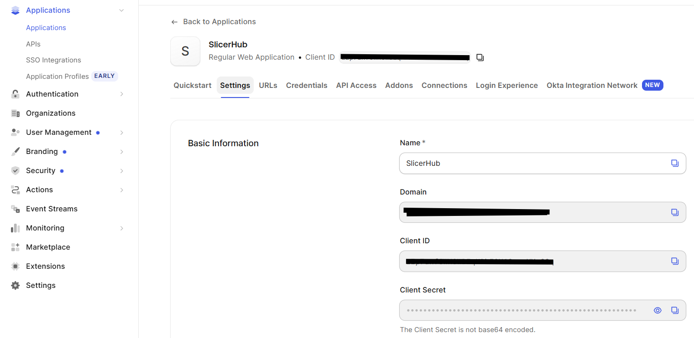

# OIDC ientity provider

The hub supports two auth modes via `HUB_AUTH_MODE`:

| Mode | Login | API Bearer |
|------|--------|------------|
| `mock` (default) | `GET /oauth/login` → JSON hub session tokens (no redirect) | Optional (`HUB_REQUIRE_AUTH`) |
| `oidc` | Browser: `GET /oauth/login` → IdP → `GET /oauth/callback` | **Required**; Bearer = hub-minted session JWT |

`POST /oauth/token` is for OIDC `client_credentials` (service providers) only.


## Deployed hubs

| Mode | URL |
|------|-----|
| **OIDC** (Auth0 login) | [https://oidc.bellehumeur-engineering.com/](https://oidc.bellehumeur-engineering.com/) — worklist: [/worklist-client/](https://oidc.bellehumeur-engineering.com/worklist-client/) |
| **Mock** (no IdP; public demos) | [https://bellehumeur-engineering.com/](https://bellehumeur-engineering.com/) — worklist: [/worklist-client/](https://bellehumeur-engineering.com/worklist-client/) |

 Slicer preset `SLICER-HUB-CLOUD-OIDC` targets the OIDC host; `SLICER-HUB-CLOUD` targets the anonymous mock auth.

## Environment

```bash
HUB_AUTH_MODE=oidc
HUB_OIDC_ISSUER=https://YOUR_TENANT.us.auth0.com
HUB_OIDC_CLIENT_ID=...
HUB_OIDC_CLIENT_SECRET=...
HUB_OIDC_REDIRECT_URI=https://oidc.bellehumeur-engineering.com/oauth/callback
HUB_PUBLIC_BASE_URL=https://oidc.bellehumeur-engineering.com
HUB_JWT_SECRET=<long random>
HUB_OIDC_TOPIC_CLAIM=email
HUB_OIDC_SCOPES=openid email profile
# Optional: allow SPA origins for return_to (localhost is always allowed)
# HUB_OIDC_RETURN_ORIGINS=https://app.example.com
```

| Variable | Purpose |
|----------|---------|
| `HUB_AUTH_MODE` | `mock` or `oidc` |
| `HUB_OIDC_ISSUER` | IdP issuer (Auth0 domain, Entra tenant, or `https://accounts.google.com`) |
| `HUB_OIDC_CLIENT_ID` / `HUB_OIDC_CLIENT_SECRET` | OAuth web client credentials |
| `HUB_OIDC_REDIRECT_URI` | Must match the IdP “callback URL” exactly (else derived from public base + `/oauth/callback`) |
| `HUB_PUBLIC_BASE_URL` | Public hub URL for redirects / auth config |
| `HUB_JWT_SECRET` | HS256 secret for hub session JWTs (**required** in oidc; not the insecure default) |
| `HUB_OIDC_TOPIC_CLAIM` | Claim used as hub topic (default `email`) |
| `HUB_OIDC_SCOPES` | Default `openid email profile` |
| `HUB_OIDC_JWKS_URL` | Optional override; otherwise JWKS from OIDC discovery |
| `HUB_OIDC_RETURN_ORIGINS` | Comma-separated SPA origins allowed for `return_to` |
| `HUB_OIDC_M2M_AUDIENCE` | Auth0 API identifier for SP `client_credentials` (required for SP connect) |
| `HUB_SP_CLIENT_IDS` | Optional allowlist of M2M `client_id`s (comma-separated or JSON array) |

Startup fails if `HUB_AUTH_MODE=oidc` and issuer/client id/secret/JWT secret are missing.

Discovery: `GET {issuer}/.well-known/openid-configuration` (works for Auth0, Google, Entra).

## Auth0 example


1. Sign up at [auth0.com](https://auth0.com/) .
2. **Applications → Create Application → Regular Web Application**.
3. **Settings**: copy Domain, Client ID, Client Secret.
4. **Allowed Callback URLs** (comma-separated), matching hub exactly, e.g.  
   `https://oidc.bellehumeur-engineering.com/oauth/callback` and/or `http://127.0.0.1:2018/oauth/callback`.
5. **Allowed Logout URLs** / **Allowed Web Origins**: `https://oidc.bellehumeur-engineering.com` (and local origin if testing).
6. Hub env: `HUB_OIDC_ISSUER=https://<Domain>` (no path; include region subdomain if Auth0 shows one, e.g. `xxx.us.auth0.com`).
7. Topic = Auth0 user **email** with `HUB_OIDC_TOPIC_CLAIM=email`.




### Auth0 Machine-to-Machine (service providers)

SPs do **not** use the Regular Web Application. Create a separate M2M app:

1. **Applications → APIs → Create API** — Identifier e.g. `https://slicer-hub/` → set hub env `HUB_OIDC_M2M_AUDIENCE` to that string.
2. **Applications → Applications → Create Application → Machine to Machine** — authorize the API from step 1.
3. Copy the M2M **Client ID** / **Client Secret** into the SP (not `HUB_OIDC_CLIENT_ID` / `SECRET`):
   - Slicer: Service Providers UI **Client ID** / **Client Secret** buttons (QSettings), or
   - Env override: `HUB_SP_CLIENT_ID` / `HUB_SP_CLIENT_SECRET` (standalone / CI).
4. Optional hub allowlist: `HUB_SP_CLIENT_IDS=<m2m-client-id>`.

Flow: SP → hub `POST /oauth/token` (`grant_type=client_credentials`) → hub exchanges with Auth0 → hub mints HS256 session JWT with `role=service_provider`, `topic=*`. Humans still cannot subscribe `topic=*`.


## Public discovery

`GET /api/hub/auth/config` returns:

- mock: `{ "mode": "mock", "login_url", "token_url", "require_auth" }`
- oidc: `{ "mode": "oidc", "login_url", "token_url", "issuer", "require_auth": true }`

## Token delivery on `return_to`

| `response_mode` | Where tokens go | Used by |
|-----------------|-----------------|---------|
| *(default)* / `fragment` | `return_to#access_token=…` | Browser SPAs / admin |
| `query` | `return_to?access_token=…` | Native Python loopback (Image Display) |

Example native login URL:

`GET /oauth/login?return_to=http://127.0.0.1:54321/&response_mode=query`

## JS HubClient (`@slicer-hub/client`)

1. `authenticate()` fetches auth config.
2. Mock: `GET login_url` with optional `user_name` / `topic` / `id_token`; applies JSON tokens (`tokensReady`); `getToken` is a no-op.
3. OIDC: redirects to `/oauth/login?return_to=<SPA URL>`; on return, parses hash tokens into `model.hub.token`, topic, and userName; `getToken` is a no-op when tokens are already present.

Prefer full-page redirect with `return_to` (popup optional later for embedded viewers).

## Admin portal (`/api/hub/admin`)

In oidc mode the admin page redirects to `/oauth/login` (same hash-token return as HubClient) and sends the hub session JWT as `Authorization: Bearer`. Optional `HUB_ADMIN_TOKEN` still works via the prompt in mock / when that secret is set.

## Conference APIs

Create/join/leave/lead (`POST`/`PATCH`/`DELETE` `/api/hub/conference*`) require Bearer when oidc is on. `@slicer-hub/client` conference helpers and SPA dialogs pass the HubClient session token as `Authorization: Bearer`.

## Python `hub_client` / Image Display

1. `GET /api/hub/auth/config` — if `mode=mock`, `GET /oauth/login` JSON tokens (`tokens_ready`).
2. If `mode=oidc`: open the **system browser** to hub `/oauth/login?…&response_mode=query` with `return_to` a local `127.0.0.1` loopback; wait for query tokens; then subscribe with Bearer.
3. Qt / Slicer does **not** embed Auth0 — only status (“Opening browser…”). A one-line HTML “Login complete” page is shown in the browser on the loopback URL.
4. Service providers: under oidc use `HubClientOptions.use_client_credentials=True` (no browser); credentials from env / QSettings / mock presets.

## Verify checklist

1. Mock: `smoke_hub_http` (login JSON) / JS+Python client pubsub smokes.
2. OIDC without required env: hub exits at startup.
3. OIDC + Auth0: HubClient → callback → Bearer subscribe/publish OK; no Bearer → 401.
4. Mock `GET /oauth/login` under oidc → IdP redirect (or 503 if not configured).
5. Native: `/oauth/login?response_mode=query` → tokens on `return_to` query string.
6. OIDC + M2M: SP `client_credentials` → subscribe `topic=*` with 202; human JWT still cannot use `*`.

